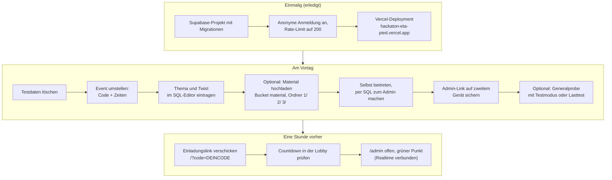
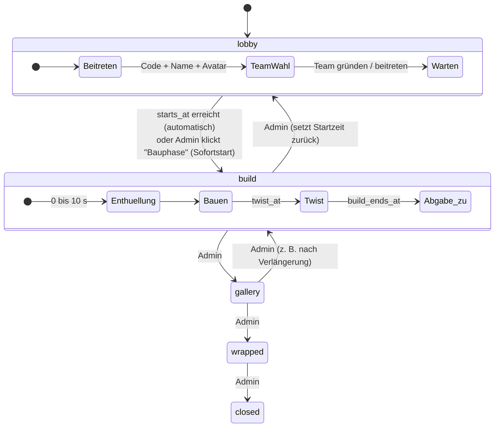
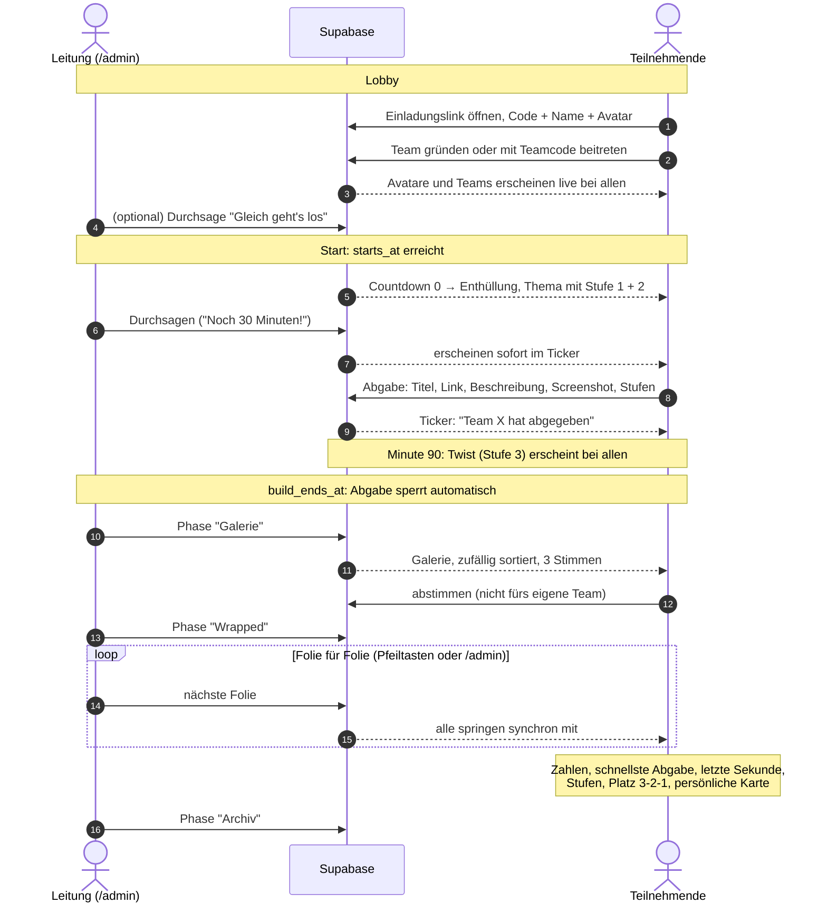
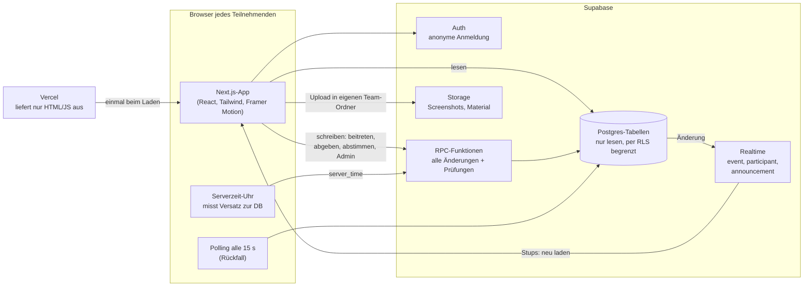
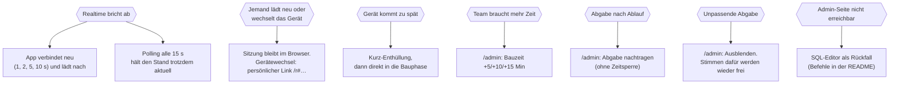

# So läuft ein Abend mit 3h/Build

Diese Seite erklärt den Ablauf von der Vorbereitung bis zum Archiv: was du als Event-Leitung
wann tust, was die Teilnehmenden sehen und was die Technik im Hintergrund macht. Die
Diagramme rendert GitHub direkt; lokal zeigt sie z. B. die Markdown-Vorschau von VS Code mit
Mermaid-Erweiterung.

**Inhalt**

1. [Die Vorbereitung](#1-die-vorbereitung)
2. [Der Abend auf einen Blick](#2-der-abend-auf-einen-blick)
3. [Die fünf Phasen](#3-die-fünf-phasen)
4. [Die drei Stunden Bauzeit](#4-die-drei-stunden-bauzeit)
5. [Wer macht was: Leitung und Teilnehmende](#5-wer-macht-was-leitung-und-teilnehmende)
6. [Wie die Technik zusammenspielt](#6-wie-die-technik-zusammenspielt)
7. [Was passiert, wenn etwas schiefgeht](#7-was-passiert-wenn-etwas-schiefgeht)

---

## 1. Die Vorbereitung

Alles, was vor dem Abend passieren muss, in der Reihenfolge, in der es Sinn ergibt.

**Warum das Thema nur in die Datenbank darf:** Die Stufen liegen in `challenge_stage` und
sind per Row Level Security erst ab ihrer Freigabezeit lesbar. Stünde das Thema im Code, im
Repository oder in einer Nachricht, wäre es vorher auffindbar.

Das echte Event stellst du im SQL-Editor um: Es gibt immer genau ein Event, es wird nicht
neu angelegt. Den geprüften SQL-Block (Testdaten löschen, Event umstellen, Thema eintragen)
findest du in der [README unter „Vom Test zum echten Abend“](../README.md#vom-test-zum-echten-abend).

Der **Titel von Stufe 1 ist das Thema**, das bei der Enthüllung groß erscheint. Wie Titel
und Texte wirken, zeigt `/admin` unter „Vorschau“, ohne etwas zu speichern.

**Material** (PDF, CSV, ZIP bis 50 MB) lädst du im Supabase-Dashboard in den privaten Bucket
`material`, Ordner = Stufennummer (`1/briefing.pdf`, `3/neue-daten.csv`). Die Dateien
erscheinen als Download-Knöpfe in der Stufenkarte, aber erst mit ihrer Stufe: Stufe 1 und 2
zum Start, Stufe 3 mit dem Twist. Vorher sind sie für niemanden abrufbar.

---

## 2. Der Abend auf einen Blick

```mermaid
flowchart LR
    L["Lobby<br/>ankommen, Teams bilden,<br/>Countdown"] -->|"starts_at erreicht<br/>(automatisch)"| R["Enthüllung<br/>10 Sekunden,<br/>alle gleichzeitig"]
    R --> B["Bauphase<br/>3 Stunden,<br/>Twist nach 90 Min"]
    B -->|"build_ends_at<br/>(Abgabe sperrt automatisch)"| Z["Zeit um"]
    Z -->|"Leitung schaltet"| G["Galerie<br/>3 Stimmen pro Person"]
    G -->|"Leitung schaltet"| W["Wrapped<br/>Folien, Siegerehrung"]
    W -->|"Leitung schaltet"| C["Archiv<br/>alle Projekte"]

    style R fill:#c8ff2e,color:#07080a
    style W fill:#c8ff2e,color:#07080a
```

Zwei Dinge passieren **von selbst**, gesteuert allein von der Datenbankzeit: Der Start (und
damit die Enthüllung) und das Ende der Abgabe. Alles danach schaltest du auf `/admin`.

---

## 3. Die fünf Phasen

Das Event hat genau eine gespeicherte Phase (`event.phase`). Die App leitet daraus und aus
den Zeiten ab, was gerade gilt.

Was in welcher Phase erlaubt ist, prüft **die Datenbank**, nicht die Oberfläche:

| | Lobby | Bauphase | Galerie | Wrapped | Archiv |
| --- | :---: | :---: | :---: | :---: | :---: |
| Beitreten | ✓ | ✓ | ✓ | ✓ | – |
| Team gründen / beitreten | ✓ | nur ohne Team | – | – | – |
| Team verlassen | ✓ | – | – | – | – |
| Thema lesen | – | ab `starts_at` | ✓ | ✓ | ✓ |
| Twist lesen | – | ab `twist_at` | ✓ | ✓ | ✓ |
| Material laden | – | mit seiner Stufe | ✓ | ✓ | ✓ |
| Abgeben / ändern | – | bis `build_ends_at` | – | – | – |
| Fremde Abgaben sehen | – | – | ✓ | ✓ | ✓ |
| Abstimmen (mit Team) | – | – | ✓ | – | – |
| Stimmenstände sehen | – | – | – | ✓ | ✓ |

---

## 4. Die drei Stunden Bauzeit

```mermaid
gantt
    title Bauphase (Beispiel: Start 19:00)
    dateFormat HH:mm
    axisFormat %H:%M

    section Bühne
    Enthüllung (10 s)          :milestone, m1, 19:00, 0m
    Twist wird enthüllt        :milestone, m2, 20:30, 0m
    Abgabe sperrt              :milestone, m3, 22:00, 0m

    section Stufen
    Stufe 1 und 2 sichtbar     :active, s1, 19:00, 180m
    Stufe 3 (Twist) sichtbar   :crit, s3, 20:30, 90m

    section Timerfarbe
    neon                       :t1, 19:00, 150m
    gelb (unter 30 Min)        :t2, 21:30, 20m
    orange (unter 10 Min)      :t3, 21:50, 9m
    rot (letzte Minute)        :crit, t4, 21:59, 1m

    section Abgabe
    offen, beliebig oft änderbar :a1, 19:00, 180m
```

- Die **Enthüllung** ist eine reine Funktion von *Serverzeit minus `starts_at`*: Alle Geräte
  zeigen dasselbe Bild, ein Reload mittendrin setzt an der richtigen Stelle fort. Wer später
  kommt, sieht eine Kurzfassung.
- Zum **Twist** fragt jedes Gerät gezielt zur richtigen Sekunde nach; Stufe 3 erscheint mit
  einem kurzen Vollbild-Auftritt.
- **Verlängern** auf `/admin` (+5/+10/+15 Min) verschiebt nur `build_ends_at` und öffnet die
  Abgabe notfalls wieder.

---

## 5. Wer macht was: Leitung und Teilnehmende

**Die Wrapped-Folien** in Reihenfolge: Intro → Zahlen → schnellste Abgabe → letzte Sekunde
→ Stufen → Platz 3 → Platz 2 → Platz 1 (Konfetti) → persönliche Karte.

**Punkte:** Stufe 1 = 10, Stufe 2 = 10, Stufe 3 = 15 (Selbstauskunft), jede erhaltene
Stimme = 5. Bei Gleichstand gewinnt die frühere Abgabe.

---

## 6. Wie die Technik zusammenspielt

Die wichtigsten Ideen:

- **Kein eigener Server.** Vercel liefert nur die Oberfläche aus. Alle Regeln (Zeitsperre,
  Stimmenlimit, Geheimhaltung, Admin-Rechte) stehen in der Datenbank: Lesen ist per Row Level
  Security begrenzt, Schreiben geht ausschließlich über geprüfte Funktionen.
- **Die Datenbankzeit entscheidet.** Jedes Gerät misst beim Laden und dann minütlich, wie weit
  seine Uhr von der Datenbank abweicht. Countdown, Enthüllung und Timer rechnen damit; eine
  falsch gestellte Handyuhr ändert nichts.
- **Realtime ist nur ein Stups.** Kommt eine Änderung, lädt die App den Stand frisch, statt die
  Nachricht selbst auszuwerten. So kann nichts auseinanderlaufen.

---

## 7. Was passiert, wenn etwas schiefgeht

Geprüft im Lasttest mit 60 gleichzeitigen Clients: Thema nach 0,35 s bei allen, Realtime-
Nachrichten in rund einer halben Sekunde, Stimmenlimit und Geheimhaltung gehalten (Details in
der README unter „Lasttest / Generalprobe“).
